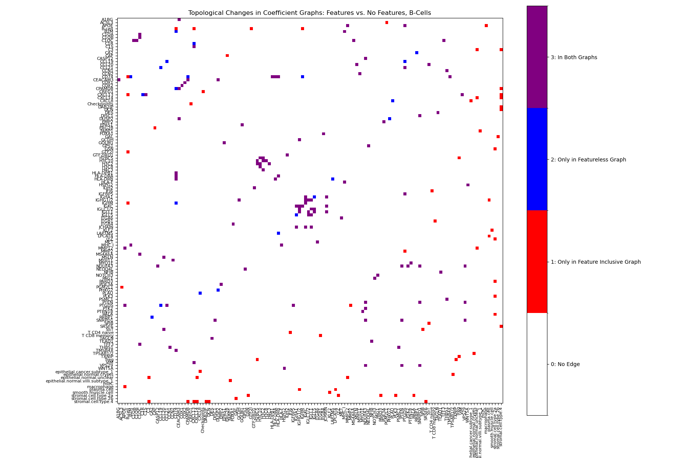
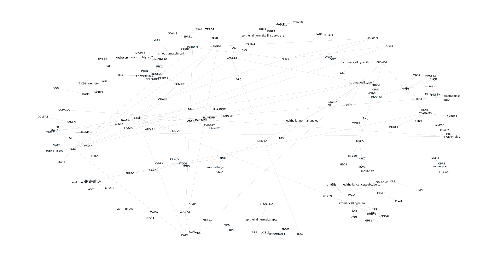
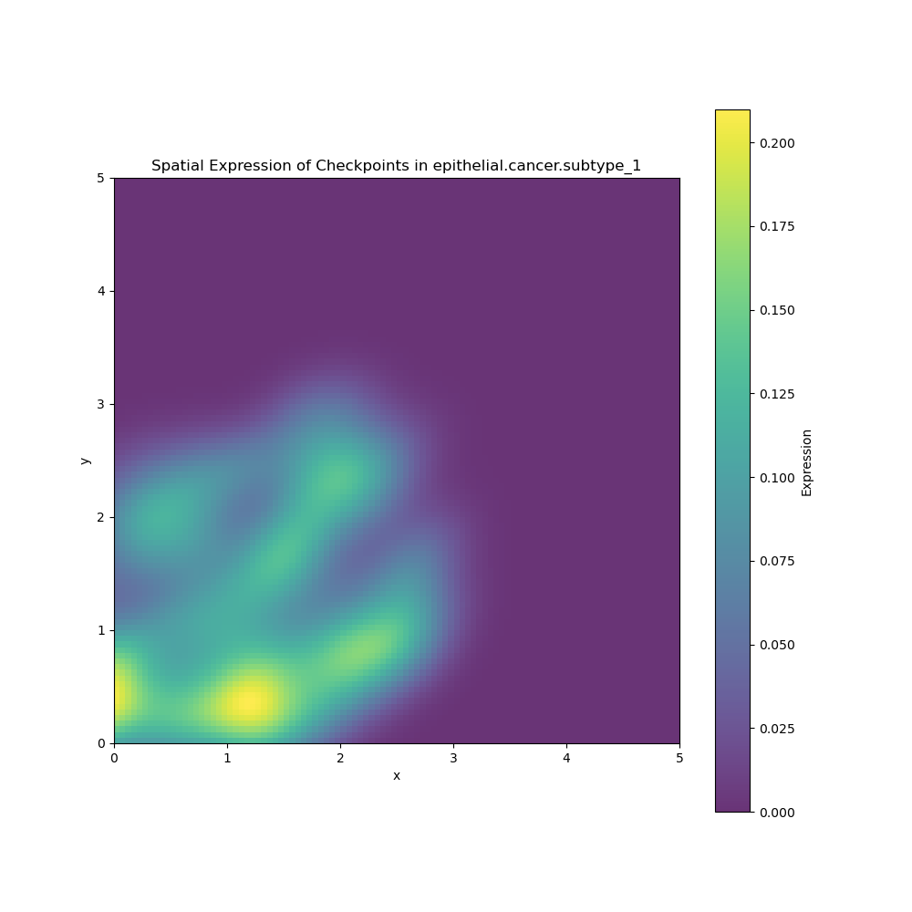
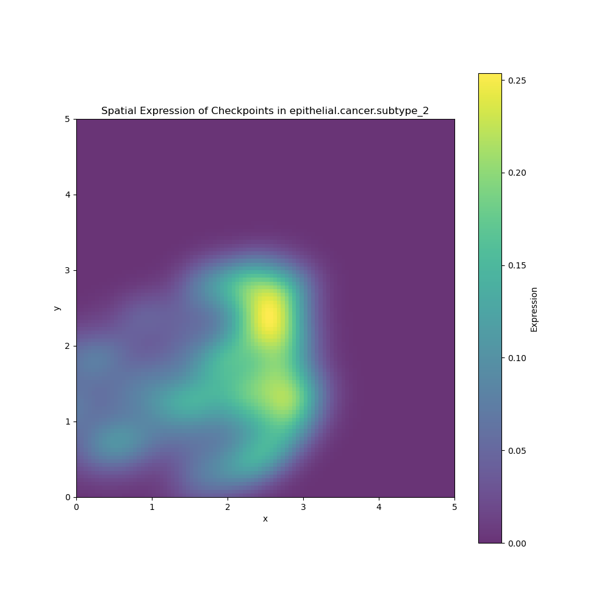
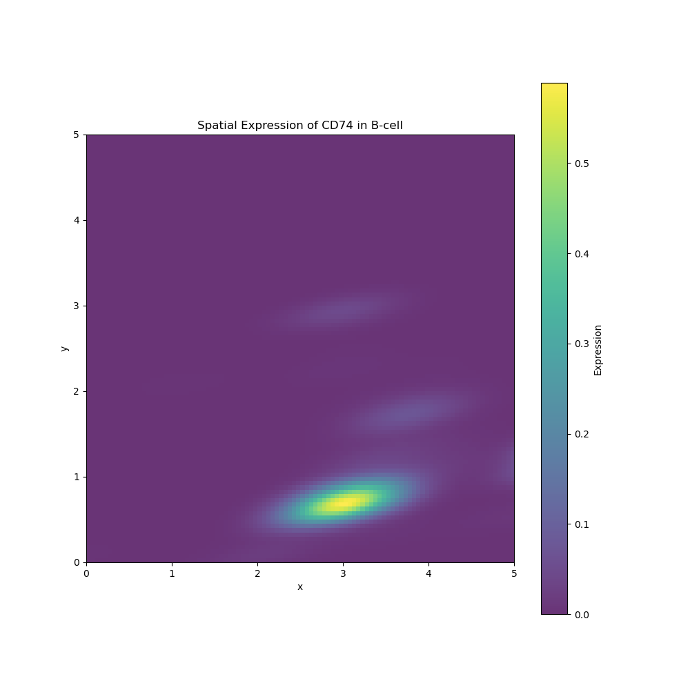
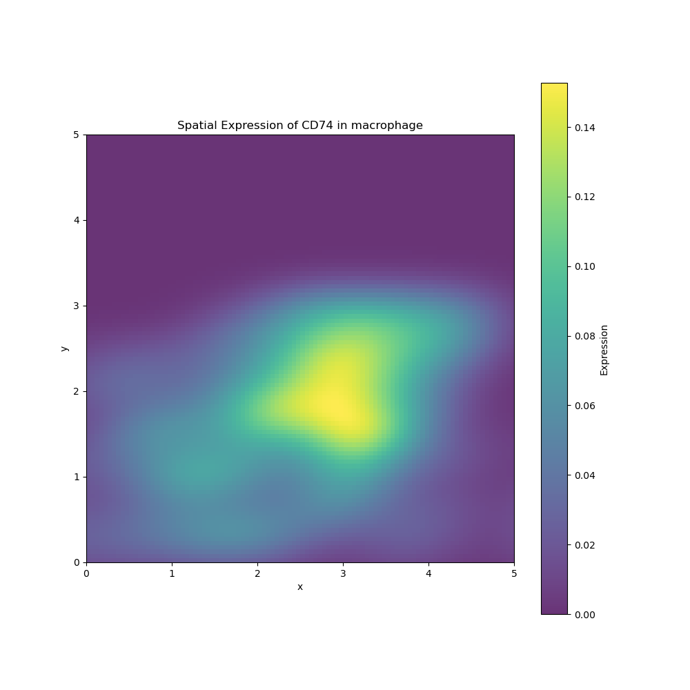
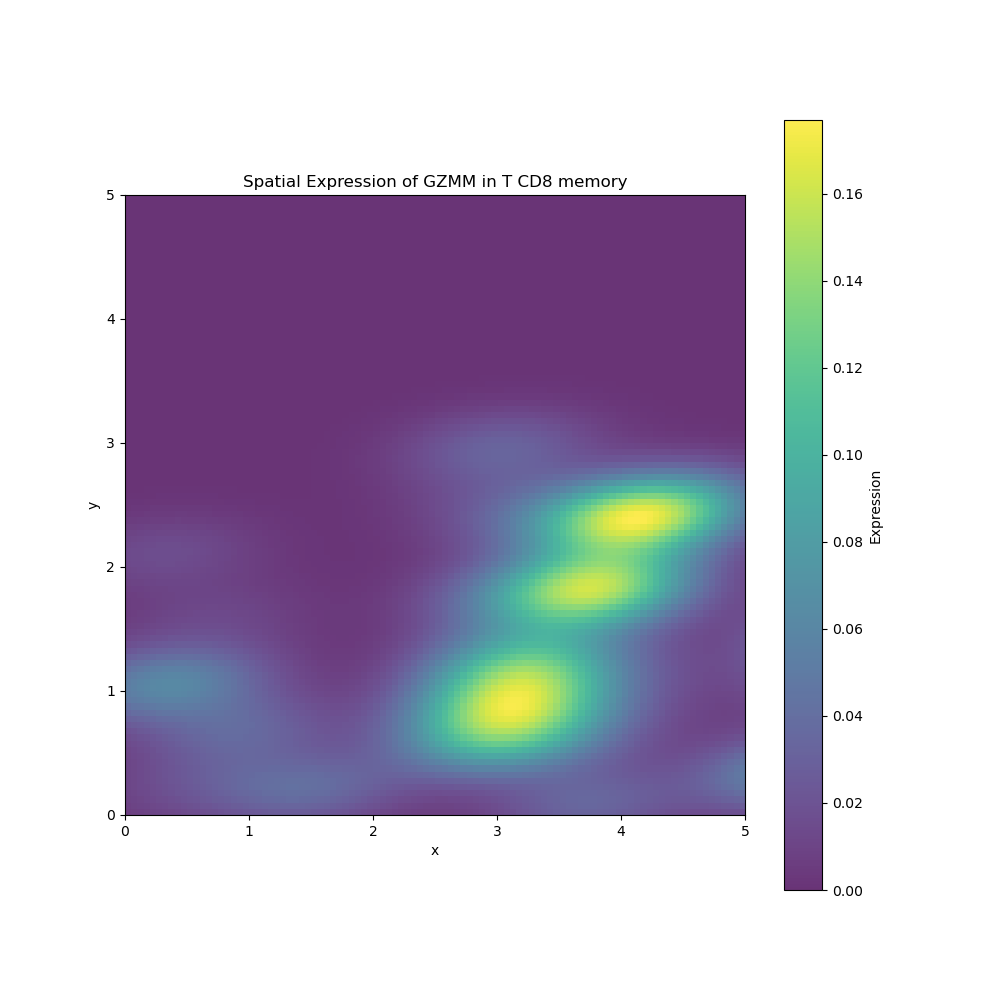
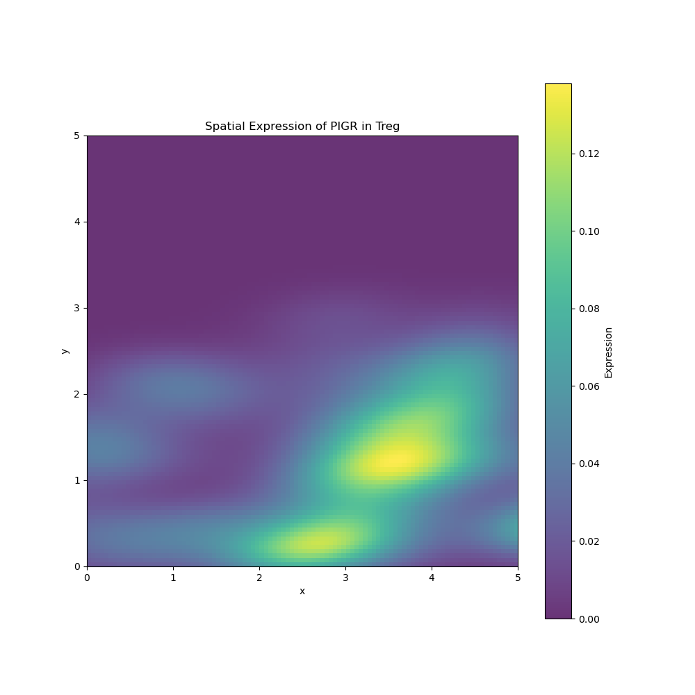

# Elastic-ST

Elastic-ST is a Python library for building gene networks from spatial transcriptomics data. Most gene network methods only see each cell's own expression. Elastic-ST also lets the network use what surrounds each cell, like the mix of nearby cell types or nearby expression of a gene set, so you can ask how a cell's neighborhood relates to its gene activity.



*Edges in a B-cell gene network that appear only when spatial features are included (red), only without them (blue), or in both (purple).*

**Status:** version 0.1.1 is on [PyPI](https://pypi.org/project/elastic-st/). The API may still change.

## How it works

For a chosen cell type, Elastic-ST fits one elastic net regression per gene, predicting that gene's expression from every other gene plus any spatial features you add. The fitted coefficients become the edges of the network.

The regressions run in parallel and use a weighted elastic net written in Cython, which gives each group of features its own regularization penalty. That lets you control how strongly the model favors spatial features, so they aren't drowned out by the much larger number of gene features.

Elastic-ST also includes tools to plot and analyze the resulting networks, map gene expression across the tissue, and compute spatial statistics such as Moran's I and Geary's C.

## Background

I started Elastic-ST in fall 2024, early in a mentorship with a scientist at Bruker Spatial Biology (formerly NanoString), to study how cells in a tumor relate to their neighbors. It's a personal project, not a Bruker product.

# Installation
```bash
pip install elastic_st
```

or install the latest version from GitHub:

```bash
pip install git+https://github.com/ThomasGust/Elastic-ST.git
```
# Getting Started
Elastic-ST needs three arrays from cell-typed spatial transcriptomics data:

- `G`: a (cells, genes) expression matrix of raw transcript counts
- `P`: a (cells, 2) matrix of cell positions
- `T`: a (cells,) array of cell type labels

You also provide the list of gene names and the list of cell types. Together these make up a `SpatialTranscriptomicsData` object:

```python
import elastic_st as est
import numpy as np
import json

if __name__ == "__main__":
    G = np.load('data/G.npy') # (cells, genes)
    P = np.load('data/P.npy') # (cells, 2)
    T = np.load('data/T.npy') # (cells,)

    annotations = json.load(open('data/annotations.json'))
    gene_names = annotations['gene_names'] # (genes,)
    cell_types = annotations['cell_types'] # (cell_types,)

    data = est.SpatialTranscriptomicsData(G, P, T, gene_names=gene_names, cell_types=cell_types)
```

# Examples
More examples are in the [examples](examples) folder. Below are the most common workflows.

## Model Training
The core of Elastic-ST is the `ElasticST` model, which fits the per-gene elastic nets and returns a sparse coefficient matrix. Spatial information enters through feature objects such as `CellTypeAbundanceFeature` and `MetageneAbundanceFeature`. A feature's `bias` sets how strongly it's favored: `bias=5` gives it a regularization penalty 5 times weaker than the genes'.

```python
import elastic_st as est
import numpy as np
import json

if __name__ == "__main__":
    #Load all raw data for the SpatialTranscriptomicsData dataset
    G = np.load('data/G.npy')
    P = np.load('data/P.npy')
    T = np.load('data/T.npy')

    annotations = json.load(open('data/annotations.json'))
    cell_types = annotations['cell_types']
    gene_names = annotations['gene_names']

    #Initialize dataset and features
    data = est.SpatialTranscriptomicsData(G, P, T, gene_names, cell_types)

    #Have a 5x weaker penalty for the spatial features
    metagene_abundance_feature = est.MetageneAbundanceFeature(bias=5, data=data, cell_type='B-cell', metagenes={'Checkpoints': ['CTLA4', 'CD274', 'TIGIT']}, radius=0.1)
    cell_type_abundance_feature = est.CellTypeAbundanceFeature(bias=5, data=data, cell_type='B-cell', radius=0.1)

    #A variance threshold removes low-variance genes that carry little information. This also speeds up model training
    data.variance_filter(threshold=0.2)

    #Train and save the model
    model = est.ElasticST(data, [metagene_abundance_feature, cell_type_abundance_feature], cell_type='B-cell', alpha=0.05, l1_ratio=0.5, subsample_to=5000)
    coeffs = model.fit(n_jobs=-1)
    np.savez_compressed('coefficients.npy', **coeffs)
```

## Network Visualization
A potential network for B cells (with high spatial bias):



Once the model is trained, `CoefficientGraphAnalysis` builds and plots the network from the coefficient matrix and provides several graph analysis utilities.

```python
import elastic_st as est
import numpy as np

if __name__ == "__main__":
    #Load coefficients record and parse it
    coeffs = np.load('coefficients.npy.npz')

    coefficients = coeffs['coefficients']
    target_names = coeffs['target_names']
    feature_names = coeffs['feature_names']

    #Create the analysis object and plot the graph
    analysis = est.CoefficientGraphAnalysis(coefficients, feature_names, target_names, graph_threshold=0.07)
    analysis.plot_graph(show=True, node_size=10, width=0.1, font_size=10, with_labels=True)

    #Also find the most central nodes as an example of graph analysis
    degree_centrality = analysis.get_graph_degree_centrality()

    #Sort the nodes by centrality
    sorted_nodes = sorted(degree_centrality.items(), key=lambda x: x[1], reverse=True)

    #Print the most central nodes
    print("Most central nodes:")
    for node, centrality in sorted_nodes[:10]:
        print(f"{node}: {centrality}")

```

## Spatial Heatmapping
Any computational result should be checked against the tissue itself. Elastic-ST can plot where a gene or gene set is expressed across the tissue, like the examples below:

<p align="center">

</p>

<p align="center">

</p>

```python
import elastic_st as est
import numpy as np
import json

if __name__ == "__main__":
    G = np.load('data/G.npy')
    P = np.load('data/P.npy')
    T = np.load('data/T.npy')

    annotations = json.load(open('data/annotations.json'))
    cell_types = annotations['cell_types']
    gene_names = annotations['gene_names']

    data = est.SpatialTranscriptomicsData(G, P, T, gene_names, cell_types)
    data.group_genes({'Checkpoints': ['CTLA4', 'CD274', 'TIGIT']}, by=np.mean) #This example aims to see the distribution of a few checkpoints in cancer cells.
    # Grouping scheme above is np.mean, by default it is np.sum for determining gene set expression for each cell.

    #Plot the spatial heatmap for the first cancer subtype in our data, plot as a fraction of total cellular expression instead of raw expression.
    est.plot_heatmap(data, cell_type='epithelial.cancer.subtype_1', gene_name='Checkpoints', show=True, as_fraction=True)
```

## Spatial Statistics
For more context on the model's output, the `SpatialStatistics` module computes common spatial statistics such as Moran's I and Geary's C.

```python
import elastic_st as est
import numpy as np
import json

if __name__ == "__main__":
    G = np.load('data/G.npy')
    P = np.load('data/P.npy')
    T = np.load('data/T.npy')

    annotations = json.load(open('data/annotations.json'))
    cell_types = annotations['cell_types']
    gene_names = annotations['gene_names']

    data = est.SpatialTranscriptomicsData(G, P, T, gene_names, cell_types)
    statistics = est.SpatialStatistics(data)

    out = statistics.full_report(cell_type='macrophage', verbose=True)
    print(list(out.keys()))
    np.savez('statistics_report_macrophage.npz', **out)
```
